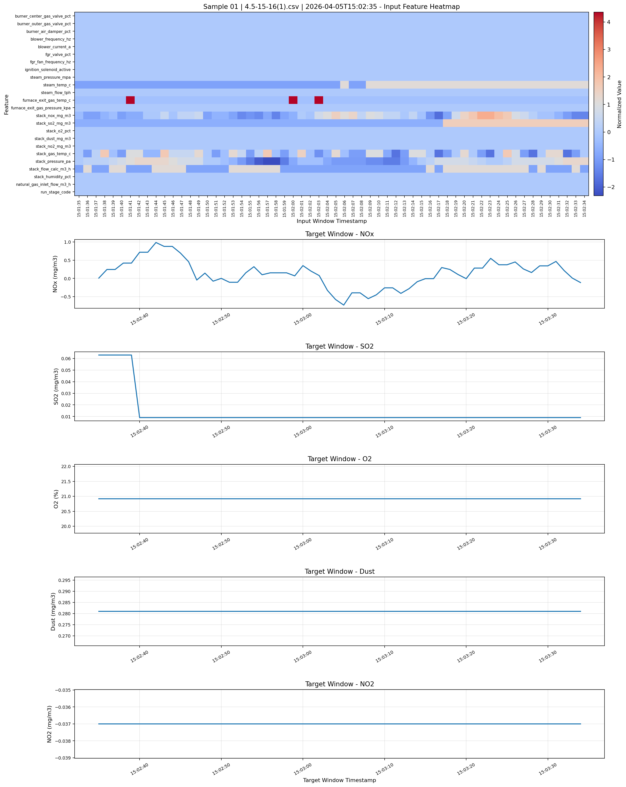
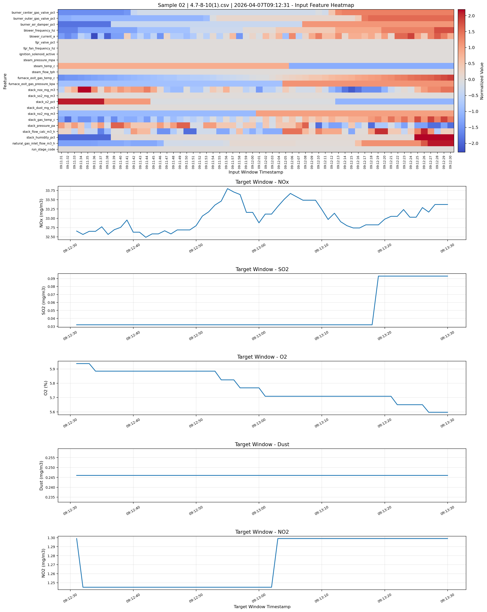
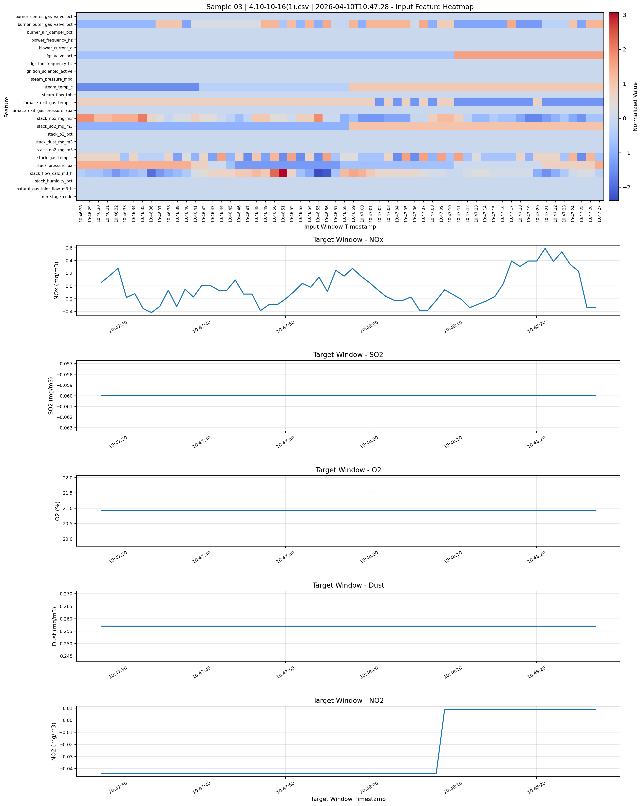
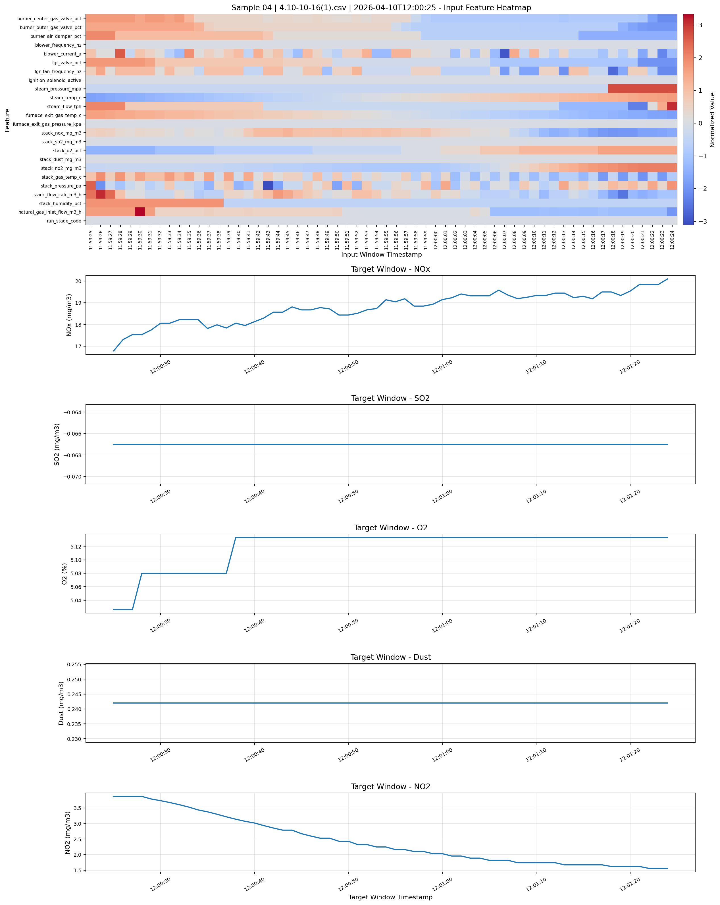
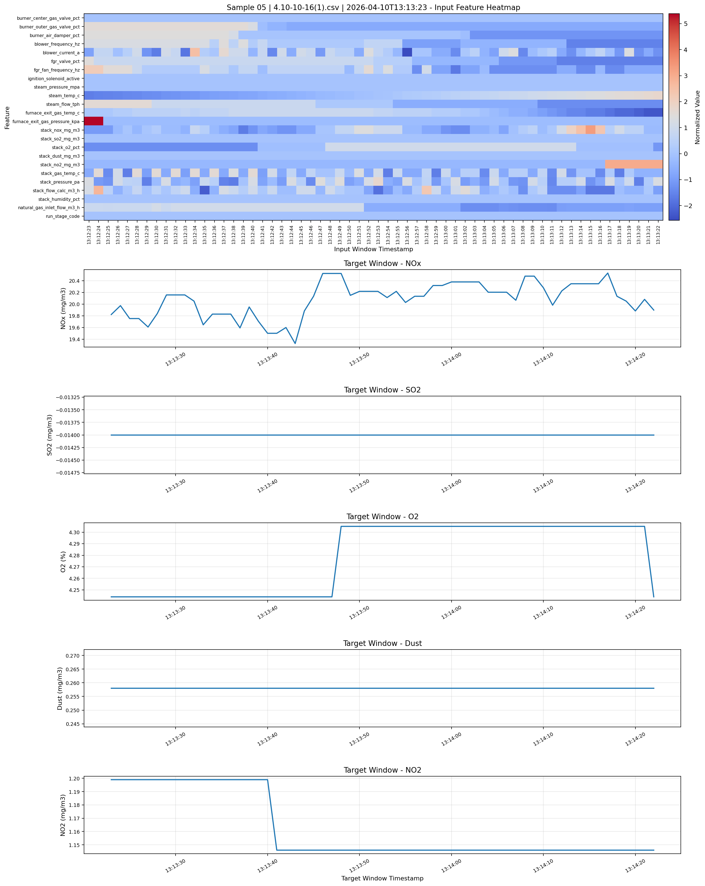
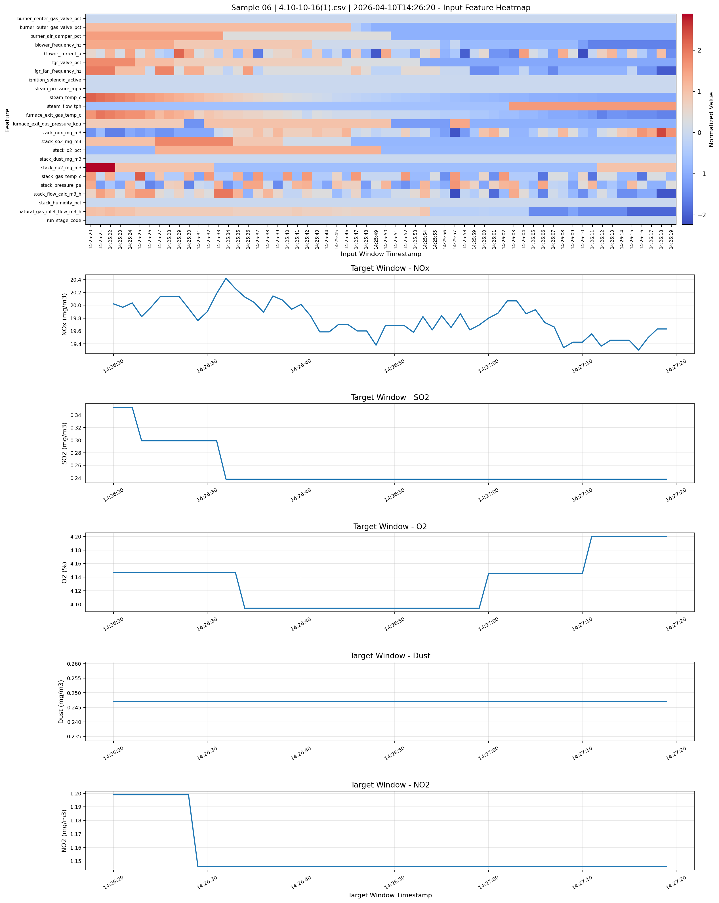
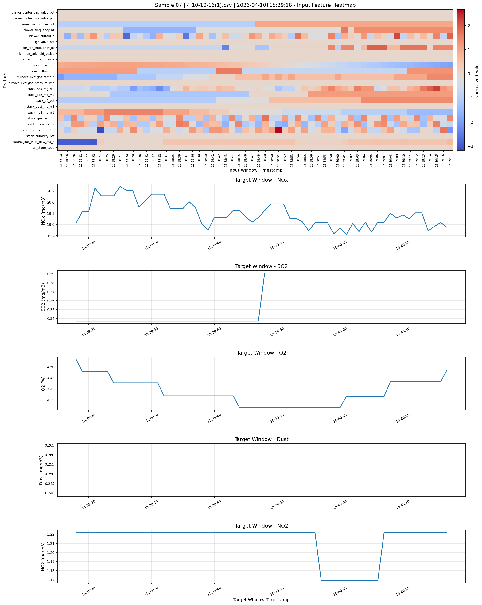
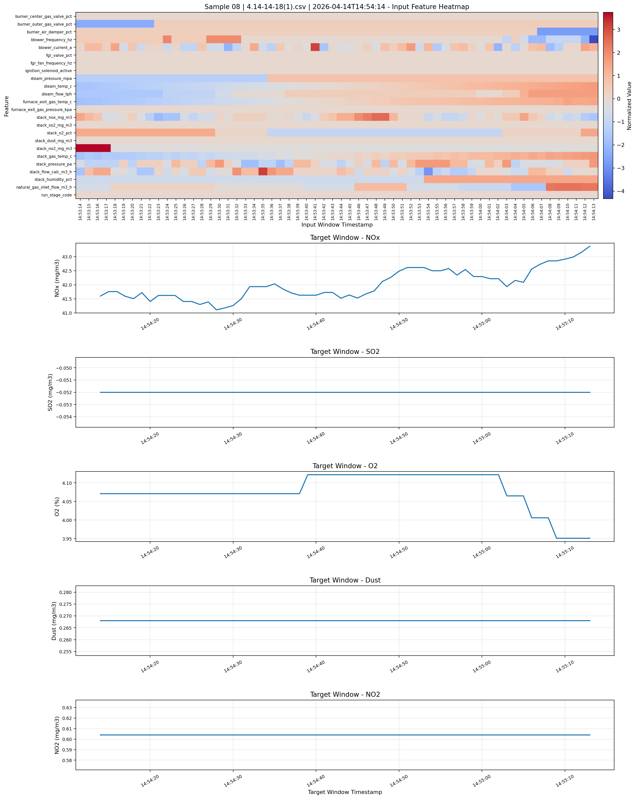
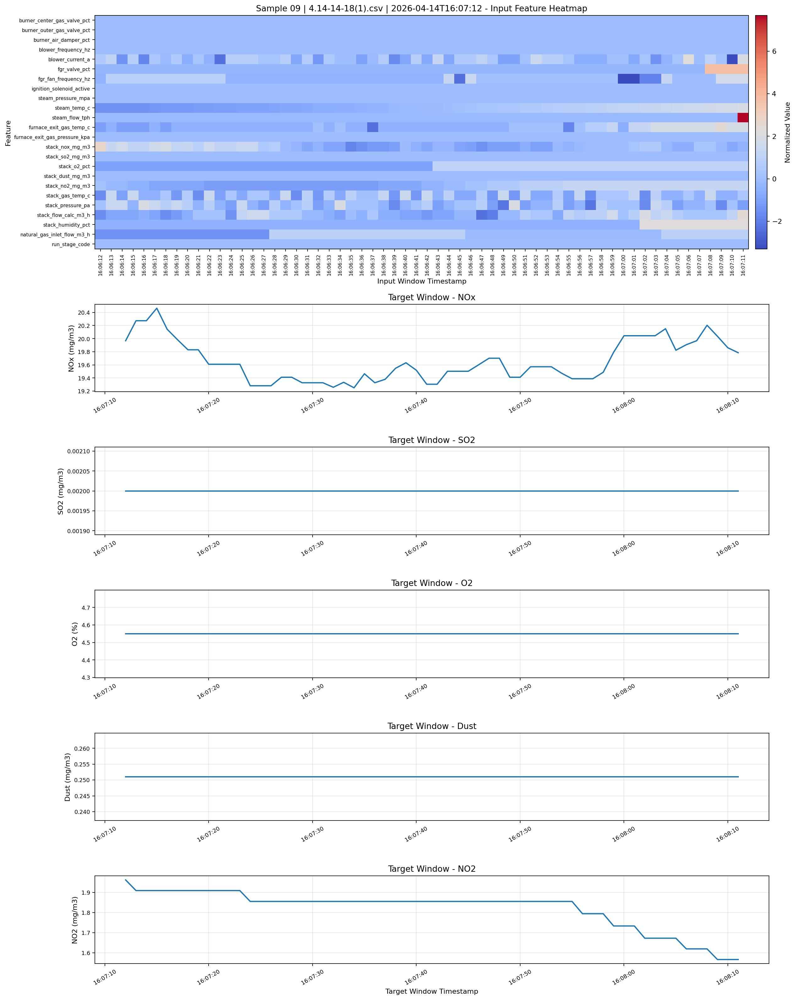
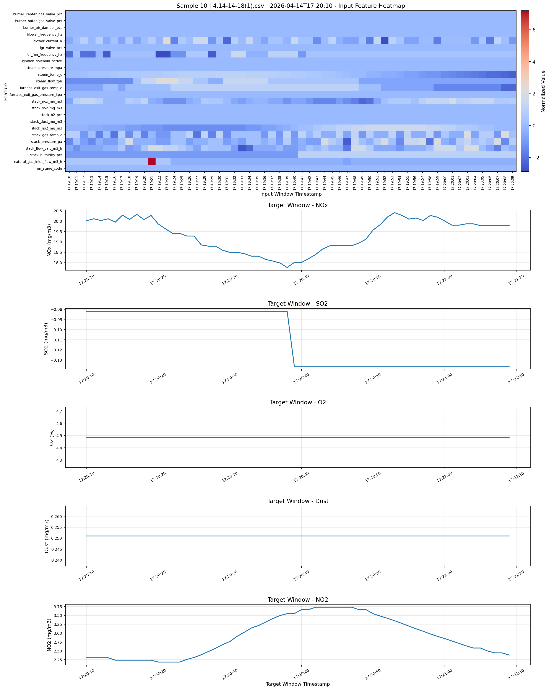

# 训练样本示例导出

## 说明

- 样本来源目录：`D:\CodeX\fengda-cnn\artifacts\samples_1s_60_60_excl_3812`
- 使用数据分区：`train`
- 导出样本数：`10`
- 选样策略：在所选分区内按时间顺序等间隔抽取。
- 每个样本均包含：`60` 秒输入窗口、`60` 秒目标窗口、完整 `csv` 数据和图表图片。

## 字段说明

- 输入特征数：`24`
- 目标变量数：`5`
- 目标变量：`stack_nox_mg_m3, stack_so2_mg_m3, stack_o2_pct, stack_dust_mg_m3, stack_no2_mg_m3`

## 样本总览

| 样本 | 来源文件 | 工况 | 输入开始 | 目标开始 | 图表 | 输入CSV | 目标CSV |
| --- | --- | --- | --- | --- | --- | --- | --- |
| sample_01 | 4.5-15-16(1).csv | shutdown | 2026-04-05T15:01:35 | 2026-04-05T15:02:35 | [chart](./sample_01_chart.png) | [input](./sample_01_input.csv) | [target](./sample_01_target.csv) |
| sample_02 | 4.7-8-10(1).csv | ramp_up | 2026-04-07T09:11:31 | 2026-04-07T09:12:31 | [chart](./sample_02_chart.png) | [input](./sample_02_input.csv) | [target](./sample_02_target.csv) |
| sample_03 | 4.10-10-16(1).csv | shutdown | 2026-04-10T10:46:28 | 2026-04-10T10:47:28 | [chart](./sample_03_chart.png) | [input](./sample_03_input.csv) | [target](./sample_03_target.csv) |
| sample_04 | 4.10-10-16(1).csv | ramp_up | 2026-04-10T11:59:25 | 2026-04-10T12:00:25 | [chart](./sample_04_chart.png) | [input](./sample_04_input.csv) | [target](./sample_04_target.csv) |
| sample_05 | 4.10-10-16(1).csv | steady_run | 2026-04-10T13:12:23 | 2026-04-10T13:13:23 | [chart](./sample_05_chart.png) | [input](./sample_05_input.csv) | [target](./sample_05_target.csv) |
| sample_06 | 4.10-10-16(1).csv | steady_run | 2026-04-10T14:25:20 | 2026-04-10T14:26:20 | [chart](./sample_06_chart.png) | [input](./sample_06_input.csv) | [target](./sample_06_target.csv) |
| sample_07 | 4.10-10-16(1).csv | steady_run | 2026-04-10T15:38:18 | 2026-04-10T15:39:18 | [chart](./sample_07_chart.png) | [input](./sample_07_input.csv) | [target](./sample_07_target.csv) |
| sample_08 | 4.14-14-18(1).csv | steady_run | 2026-04-14T14:53:14 | 2026-04-14T14:54:14 | [chart](./sample_08_chart.png) | [input](./sample_08_input.csv) | [target](./sample_08_target.csv) |
| sample_09 | 4.14-14-18(1).csv | ramp_up | 2026-04-14T16:06:12 | 2026-04-14T16:07:12 | [chart](./sample_09_chart.png) | [input](./sample_09_input.csv) | [target](./sample_09_target.csv) |
| sample_10 | 4.14-14-18(1).csv | ramp_up | 2026-04-14T17:19:10 | 2026-04-14T17:20:10 | [chart](./sample_10_chart.png) | [input](./sample_10_input.csv) | [target](./sample_10_target.csv) |

## sample_01

- 分区内样本索引：`0`
- 来源文件：`4.5-15-16(1).csv`
- 工况：`shutdown`
- 输入窗口：`2026-04-05T15:01:35` 到 `2026-04-05T15:02:34`
- 目标窗口：`2026-04-05T15:02:35` 到 `2026-04-05T15:03:34`
- 数据文件：[input](./sample_01_input.csv) / [target](./sample_01_target.csv)

| 目标变量 | 均值 | 最小值 | 最大值 |
| --- | ---: | ---: | ---: |
| stack_nox_mg_m3 (mg/m3) | 0.1360 | -0.7310 | 0.9860 |
| stack_so2_mg_m3 (mg/m3) | 0.0135 | 0.0090 | 0.0630 |
| stack_o2_pct (%) | 20.9160 | 20.9160 | 20.9160 |
| stack_dust_mg_m3 (mg/m3) | 0.2810 | 0.2810 | 0.2810 |
| stack_no2_mg_m3 (mg/m3) | -0.0370 | -0.0370 | -0.0370 |

## sample_02

- 分区内样本索引：`4377`
- 来源文件：`4.7-8-10(1).csv`
- 工况：`ramp_up`
- 输入窗口：`2026-04-07T09:11:31` 到 `2026-04-07T09:12:30`
- 目标窗口：`2026-04-07T09:12:31` 到 `2026-04-07T09:13:30`
- 数据文件：[input](./sample_02_input.csv) / [target](./sample_02_target.csv)

| 目标变量 | 均值 | 最小值 | 最大值 |
| --- | ---: | ---: | ---: |
| stack_nox_mg_m3 (mg/m3) | 33.0224 | 32.4870 | 33.8000 |
| stack_so2_mg_m3 (mg/m3) | 0.0442 | 0.0320 | 0.0930 |
| stack_o2_pct (%) | 5.7764 | 5.5970 | 5.9380 |
| stack_dust_mg_m3 (mg/m3) | 0.2460 | 0.2460 | 0.2460 |
| stack_no2_mg_m3 (mg/m3) | 1.2711 | 1.2450 | 1.2990 |

## sample_03

- 分区内样本索引：`8755`
- 来源文件：`4.10-10-16(1).csv`
- 工况：`shutdown`
- 输入窗口：`2026-04-10T10:46:28` 到 `2026-04-10T10:47:27`
- 目标窗口：`2026-04-10T10:47:28` 到 `2026-04-10T10:48:27`
- 数据文件：[input](./sample_03_input.csv) / [target](./sample_03_target.csv)

| 目标变量 | 均值 | 最小值 | 最大值 |
| --- | ---: | ---: | ---: |
| stack_nox_mg_m3 (mg/m3) | -0.0417 | -0.4180 | 0.5890 |
| stack_so2_mg_m3 (mg/m3) | -0.0600 | -0.0600 | -0.0600 |
| stack_o2_pct (%) | 20.9110 | 20.9110 | 20.9110 |
| stack_dust_mg_m3 (mg/m3) | 0.2570 | 0.2570 | 0.2570 |
| stack_no2_mg_m3 (mg/m3) | -0.0272 | -0.0440 | 0.0090 |

## sample_04

- 分区内样本索引：`13132`
- 来源文件：`4.10-10-16(1).csv`
- 工况：`ramp_up`
- 输入窗口：`2026-04-10T11:59:25` 到 `2026-04-10T12:00:24`
- 目标窗口：`2026-04-10T12:00:25` 到 `2026-04-10T12:01:24`
- 数据文件：[input](./sample_04_input.csv) / [target](./sample_04_target.csv)

| 目标变量 | 均值 | 最小值 | 最大值 |
| --- | ---: | ---: | ---: |
| stack_nox_mg_m3 (mg/m3) | 18.7858 | 16.7860 | 20.0970 |
| stack_so2_mg_m3 (mg/m3) | -0.0670 | -0.0670 | -0.0670 |
| stack_o2_pct (%) | 5.1188 | 5.0260 | 5.1330 |
| stack_dust_mg_m3 (mg/m3) | 0.2420 | 0.2420 | 0.2420 |
| stack_no2_mg_m3 (mg/m3) | 2.4323 | 1.5580 | 3.8700 |

## sample_05

- 分区内样本索引：`17510`
- 来源文件：`4.10-10-16(1).csv`
- 工况：`steady_run`
- 输入窗口：`2026-04-10T13:12:23` 到 `2026-04-10T13:13:22`
- 目标窗口：`2026-04-10T13:13:23` 到 `2026-04-10T13:14:22`
- 数据文件：[input](./sample_05_input.csv) / [target](./sample_05_target.csv)

| 目标变量 | 均值 | 最小值 | 最大值 |
| --- | ---: | ---: | ---: |
| stack_nox_mg_m3 (mg/m3) | 20.0817 | 19.3270 | 20.5320 |
| stack_so2_mg_m3 (mg/m3) | -0.0140 | -0.0140 | -0.0140 |
| stack_o2_pct (%) | 4.2786 | 4.2440 | 4.3050 |
| stack_dust_mg_m3 (mg/m3) | 0.2580 | 0.2580 | 0.2580 |
| stack_no2_mg_m3 (mg/m3) | 1.1619 | 1.1460 | 1.1990 |

## sample_06

- 分区内样本索引：`21887`
- 来源文件：`4.10-10-16(1).csv`
- 工况：`steady_run`
- 输入窗口：`2026-04-10T14:25:20` 到 `2026-04-10T14:26:19`
- 目标窗口：`2026-04-10T14:26:20` 到 `2026-04-10T14:27:19`
- 数据文件：[input](./sample_06_input.csv) / [target](./sample_06_target.csv)

| 目标变量 | 均值 | 最小值 | 最大值 |
| --- | ---: | ---: | ---: |
| stack_nox_mg_m3 (mg/m3) | 19.7869 | 19.3040 | 20.4180 |
| stack_so2_mg_m3 (mg/m3) | 0.2529 | 0.2380 | 0.3520 |
| stack_o2_pct (%) | 4.1316 | 4.0940 | 4.2000 |
| stack_dust_mg_m3 (mg/m3) | 0.2470 | 0.2470 | 0.2470 |
| stack_no2_mg_m3 (mg/m3) | 1.1540 | 1.1460 | 1.1990 |

## sample_07

- 分区内样本索引：`26265`
- 来源文件：`4.10-10-16(1).csv`
- 工况：`steady_run`
- 输入窗口：`2026-04-10T15:38:18` 到 `2026-04-10T15:39:17`
- 目标窗口：`2026-04-10T15:39:18` 到 `2026-04-10T15:40:17`
- 数据文件：[input](./sample_07_input.csv) / [target](./sample_07_target.csv)

| 目标变量 | 均值 | 最小值 | 最大值 |
| --- | ---: | ---: | ---: |
| stack_nox_mg_m3 (mg/m3) | 19.7910 | 19.4180 | 20.2800 |
| stack_so2_mg_m3 (mg/m3) | 0.3640 | 0.3370 | 0.3910 |
| stack_o2_pct (%) | 4.3844 | 4.3150 | 4.5340 |
| stack_dust_mg_m3 (mg/m3) | 0.2520 | 0.2520 | 0.2520 |
| stack_no2_mg_m3 (mg/m3) | 1.2132 | 1.1690 | 1.2220 |

## sample_08

- 分区内样本索引：`30642`
- 来源文件：`4.14-14-18(1).csv`
- 工况：`steady_run`
- 输入窗口：`2026-04-14T14:53:14` 到 `2026-04-14T14:54:13`
- 目标窗口：`2026-04-14T14:54:14` 到 `2026-04-14T14:55:13`
- 数据文件：[input](./sample_08_input.csv) / [target](./sample_08_target.csv)

| 目标变量 | 均值 | 最小值 | 最大值 |
| --- | ---: | ---: | ---: |
| stack_nox_mg_m3 (mg/m3) | 42.0057 | 41.1090 | 43.3670 |
| stack_so2_mg_m3 (mg/m3) | -0.0520 | -0.0520 | -0.0520 |
| stack_o2_pct (%) | 4.0779 | 3.9510 | 4.1220 |
| stack_dust_mg_m3 (mg/m3) | 0.2680 | 0.2680 | 0.2680 |
| stack_no2_mg_m3 (mg/m3) | 0.6040 | 0.6040 | 0.6040 |

## sample_09

- 分区内样本索引：`35020`
- 来源文件：`4.14-14-18(1).csv`
- 工况：`ramp_up`
- 输入窗口：`2026-04-14T16:06:12` 到 `2026-04-14T16:07:11`
- 目标窗口：`2026-04-14T16:07:12` 到 `2026-04-14T16:08:11`
- 数据文件：[input](./sample_09_input.csv) / [target](./sample_09_target.csv)

| 目标变量 | 均值 | 最小值 | 最大值 |
| --- | ---: | ---: | ---: |
| stack_nox_mg_m3 (mg/m3) | 19.6506 | 19.2500 | 20.4640 |
| stack_so2_mg_m3 (mg/m3) | 0.0020 | 0.0020 | 0.0020 |
| stack_o2_pct (%) | 4.5490 | 4.5490 | 4.5490 |
| stack_dust_mg_m3 (mg/m3) | 0.2510 | 0.2510 | 0.2510 |
| stack_no2_mg_m3 (mg/m3) | 1.8191 | 1.5660 | 1.9620 |

## sample_10

- 分区内样本索引：`39398`
- 来源文件：`4.14-14-18(1).csv`
- 工况：`ramp_up`
- 输入窗口：`2026-04-14T17:19:10` 到 `2026-04-14T17:20:09`
- 目标窗口：`2026-04-14T17:20:10` 到 `2026-04-14T17:21:09`
- 数据文件：[input](./sample_10_input.csv) / [target](./sample_10_target.csv)

| 目标变量 | 均值 | 最小值 | 最大值 |
| --- | ---: | ---: | ---: |
| stack_nox_mg_m3 (mg/m3) | 19.3518 | 17.7630 | 20.4100 |
| stack_so2_mg_m3 (mg/m3) | -0.1099 | -0.1360 | -0.0820 |
| stack_o2_pct (%) | 4.4850 | 4.4850 | 4.4850 |
| stack_dust_mg_m3 (mg/m3) | 0.2510 | 0.2510 | 0.2510 |
| stack_no2_mg_m3 (mg/m3) | 2.8955 | 2.1840 | 3.7320 |
